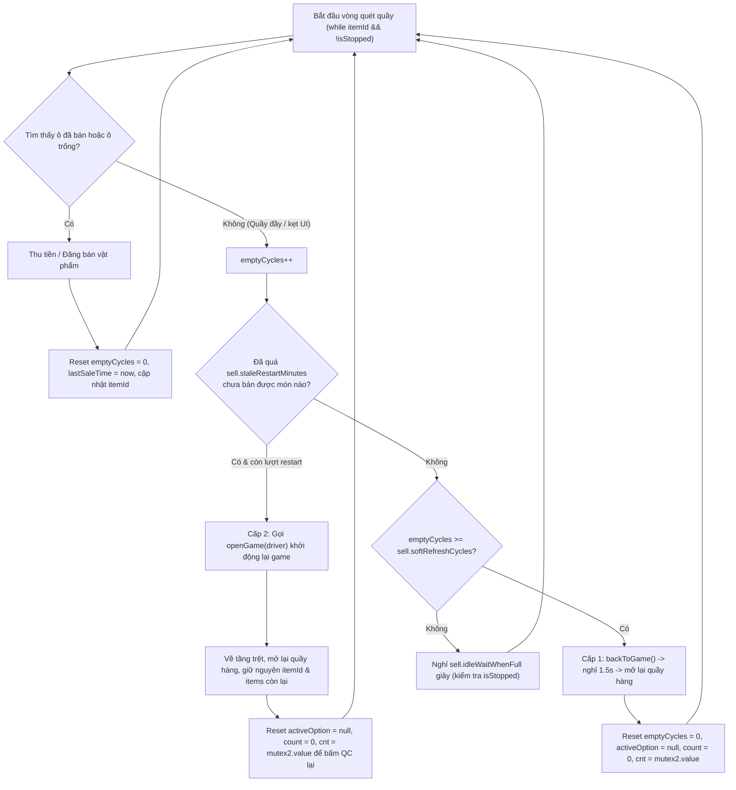

# Kế hoạch phát triển tính năng mới — Auto-kvtm

Tài liệu đặc tả kế hoạch nâng cấp **Auto-kvtm** theo quy trình Spec-Driven Development (SDD), bao gồm giải pháp **Chống kẹt bán hàng ban đêm 2 cấp** và lộ trình **3 đợt** phát triển tính năng.

---

## 1. Tổng quan & Mục tiêu

- **Mục tiêu cốt lõi:** Giúp tool treo máy qua đêm bền bỉ không bị kẹt quầy bán đồ, giảm tải CPU/ổ cứng khi chạy nhiều giả lập song song, tăng khả năng quan sát trạng thái realtime và cảnh báo từ xa, đồng thời bổ sung bộ công cụ tiện ích cho người dùng nâng cao.
- **Nguyên tắc thiết kế:**
  - Tham số tinh chỉnh quản lý tập trung trong `server/src/services/paramsSchema.js`, có giá trị mặc định an toàn để không làm thay đổi hành vi cũ khi người dùng chưa bật/chỉnh.
  - Dữ liệu cá nhân của người dùng (`data/profiles.json`, `data/notify_user.json`, `data/stats.json`) được liệt kê vào `.gitignore` và ghi theo cơ chế atomic (`writeJsonAtomic`) trên Windows.
  - Luôn kiểm tra `driver.isStopped?.()` trong mọi vòng lặp chờ kéo dài để nút **Stop** phản hồi tức thì.

---

## 2. Thiết kế chi tiết: Chống kẹt bán hàng 2 cấp ban đêm (Night-safe Selling)

### 2.1. Phân tích vấn đề hiện tại
Trong `server/src/games/sky-garden/core.js`:
- Tại `sellItems` (nhánh `else if (!loop)`): khi quầy đầy và không thấy `o-da-ban` (`ItemKeys.soldSlot`) hoặc `o-trong-ban` (`ItemKeys.emptySellSlot`), code chỉ vuốt quầy về đầu rồi quét lặp lại liên tục mà **không nghỉ**, **không đóng/mở lại quầy** và **không khởi động lại game**.
- Tại `sellEventItems`: nếu `count > 2`, có đóng/mở lại quầy nhưng **`cnt = 0` bị reset về 0**, làm mất số lượng đã bán trước đó (dẫn đến bán dư hoặc lặp vô hạn); ngoài ra khi `isAds === false`, nhánh `if (!isAds) continue` bỏ qua phần cuộn quầy và chạy vòng lặp rỗng liên tục.
- Khi treo ban đêm vài giờ không có người mua hoặc game lag/desync giao diện (server đã bán nhưng client không cập nhật icon `o-da-ban`), tool quét ảnh OpenCV liên tục gây nóng máy và đứng kẹt tại bảng quầy.

### 2.2. Luồng phục hồi 2 cấp

### 2.3. Tham số cấu hình mới trong `server/src/services/paramsSchema.js` (nhóm `sell`)

| Key | Nhãn | Mặc định | Min / Max / Step | Đơn vị | Mô tả |
|---|---|---|---|---|---|
| `sell.idleWaitWhenFull` | Nghỉ khi quầy đầy | `5` | `0` – `60` (`1`) | `s` | Thời gian chờ mỗi lượt khi tất cả ô bán đều đang bận, tránh quét ảnh liên tục 100% CPU. |
| `sell.softRefreshCycles` | Làm mới quầy sau số chu kỳ trống | `4` | `0` – `50` (`1`) | `chu kỳ` | Số chu kỳ quét không bán được hàng trước khi đóng bảng quầy và mở lại (`0` = tắt). |
| `sell.staleRestartMinutes` | Khởi động lại game nếu kẹt bán quá | `120` | `0` – `720` (`1`) | `phút` | Thời gian tối đa không bán được thêm món nào trước khi thoát game vào lại để đồng bộ server (`120` = 2 tiếng, `0` = tắt). |
| `sell.maxStaleRestarts` | Giới hạn số lần restart khi kẹt bán | `0` | `0` – `50` (`1`) | `lần` | `0` = không giới hạn (tiếp tục bán tới khi đủ số lượng hoặc người dùng bấm Stop). |

### 2.4. Ràng buộc & Edge cases bắt buộc
1. **Bảo toàn chính xác số lượng còn lại (`items` & `itemId`):**
   - Trong `sellItems`, `itemId` hiện tại đã được trừ `1` trong `items` khi `_getItemId(items)` trả về; khi thực hiện Cấp 1 (đóng/mở quầy) hoặc Cấp 2 (`openGame`), tuyệt đối **không** gọi lại `_getItemId(items)` mà giữ nguyên biến `itemId` và mảng `items` hiện tại để tiếp tục bán nốt.
   - Trong `sellEventItems`, loại bỏ dòng `cnt = 0` khi đóng/mở quầy hoặc restart game để giữ nguyên số lượng đã bán `cnt`.
2. **Xử lý khi `isAds === false` ở `sellEventItems`:** Không nhảy `continue` ngay trước khi tăng bộ đếm chu kỳ trống/`idleWaitWhenFull`; chỉ bỏ qua bước bấm quảng cáo (`chuaqc`), vẫn chờ `idleWaitWhenFull` và kích hoạt phục hồi Cấp 1 / Cấp 2 bình thường.
3. **Bấm lại quảng cáo sau phục hồi:** Reset `cnt = mutex2.value` và `activeOption = null` sau khi đóng/mở quầy hoặc restart game để tool kiểm tra lại `chuaqc` và chọn đúng tab danh mục.
4. **Dừng tức thì (`driver.isStopped?.()`):** Kiểm tra ở đầu mỗi vòng lặp `while`, trước khi gọi `openGame(driver)`, và chia nhỏ `sleep` hoặc kiểm tra trước/sau `idleWaitWhenFull` để lệnh Stop không phải chờ hết chu kỳ nghỉ.
5. **Tránh vòng lặp restart vô hạn nếu mất kết nối hẳn:** Tôn trọng `sell.maxStaleRestarts` (nếu `> 0`) và giới hạn `_retryDepth` có sẵn trong `openGame`.

---

## 3. Lộ trình triển khai chi tiết (3 Đợt)

### Đợt 1 — Ưu tiên cao: Treo đêm ổn định, Hiệu năng & Tiện ích hằng ngày

#### 1.1. Chống kẹt bán hàng 2 cấp (Night-safe Selling)
- **File ảnh hưởng:**
  - `server/src/services/paramsSchema.js`
  - `server/src/games/sky-garden/core.js`
- **Checklist công việc:**
  - [x] Thêm 4 tham số nhóm `sell` (`sell.idleWaitWhenFull`, `sell.softRefreshCycles`, `sell.staleRestartMinutes`, `sell.maxStaleRestarts`) vào `paramsSchema.js`.
  - [x] Tách helper dùng chung (`_sleepInterruptible`, `_scrollShopToStart`, `_reopenShop`, `_recoverStaleShop`) trong `core.js` để dùng lại giữa `sellItems` và `sellEventItems`, tránh trùng lặp logic.
  - [x] Áp dụng cơ chế nghỉ khi quầy đầy + Cấp 1 (đóng/mở quầy) + Cấp 2 (`openGame`) vào `sellItems` (nhánh `!loop`) và `sellEventItems` (bảo toàn `itemId`/`items`/`cnt`).
  - [x] Bổ sung kiểm tra `driver.isStopped?.()` trong vòng lặp bán hàng và ghi log rõ ràng từng cấp phục hồi.

#### 1.2. Cache template OpenCV `Mat` trong RAM
- **File ảnh hưởng:**
  - `server/src/engine/image.js`
  - `server/src/api/images.js`
  - `server/src/api/upload.js`
- **Checklist công việc:**
  - [x] Xây dựng `templateCache` (`Map<resolvedPath, { mtimeMs, mat }>`) trong `image.js` kèm cơ chế LRU/giới hạn tối đa 100 entry và hàm `invalidateTemplateCache(filePath?)`.
  - [x] Với `detectBugInROIs`, cache cả cặp `{ name, mtimeMs, normal, flipped }` (`bugTemplateCache`) theo template bọ; không gọi `.delete()` trên `Mat` thuộc cache trong khối `finally`.
  - [x] Kiểm tra `fs.statSync(path).mtimeMs` khi lấy từ cache; nếu file thay đổi thì xóa `Mat` cũ và nạp lại.
  - [x] Gọi `invalidateTemplateCache(...)` khi cập nhật hoặc xóa ảnh tại `images.js` (`updateImage`, `deleteImage`) và `upload.js` (`handleUpload`).

#### 1.3. Thanh System Health Bar trên Header
- **File ảnh hưởng:**
  - `server/src/api/health.js` (mới)
  - `server/src/router.js`
  - `client/src/component/HealthBar.jsx` (mới)
  - `client/src/App.jsx`
- **Checklist công việc:**
  - [x] Tạo endpoint `GET /api/health` kiểm tra song song với timeout ngắn (~1.2s):
    - **ADB:** cổng `ANDROID_ADB_SERVER_PORT`, danh sách/số thiết bị online.
    - **Appium:** HTTP GET tới `http://${APPIUM_HOST}:${APPIUM_PORT}/wd/hub/status`.
    - **Python OCR Server:** HTTP GET tới `http://127.0.0.1:5000/ping`.
    - **Node Process:** mức RAM RSS (`process.memoryUsage().rss`), số session đang chạy và thống kê cache.
  - [x] Đăng ký route `/health` trong `server/src/router.js`.
  - [x] Tạo `HealthBar.jsx` hiển thị badge trạng thái gọn trên Header `App.jsx`, tự động poll mỗi 10 giây (tạm dừng khi tab ẩn) và có nút làm mới thủ công + tooltip chi tiết.

#### 1.4. Lưu cấu hình & Profile theo từng thiết bị (Presets)
- **File ảnh hưởng:**
  - `.gitignore`
  - `server/src/services/profiles.js` (mới)
  - `server/src/api/profiles.js` (mới)
  - `server/src/router.js`
  - `server/src/engine/runner.js` / `server/src/engine/webdriverio.js`
  - `client/src/component/Filter/Game/SkyGarden.jsx`
  - `client/src/component/Filter/Filter.jsx`
- **Checklist công việc:**
  - [x] Thêm `data/profiles.json` vào `.gitignore`.
  - [x] Tạo `profiles.js` quản lý CRUD profile (`id`, `name`, `selectedGame`, `selectedAuto`, `gameOptions`, `deviceIds`, `speedMultiplierOverride`), ghi bằng `writeJsonAtomic`.
  - [x] Tạo API `GET /api/profiles`, `POST /api/profiles`, `DELETE /api/profiles/:id` trong `api/profiles.js` và gắn vào `router.js`.
  - [x] Cập nhật `SkyGarden.jsx` & `Filter.jsx`: tự động lưu/khôi phục lựa chọn gần nhất (`localStorage`), dropdown chọn/lưu/xóa Profile, cấu hình `speedMultiplierOverride` theo Profile, và nút **"Chạy tất cả Profile"** tuần tự các thiết bị không bị trùng.

---

### Đợt 2 — Treo máy dài hạn & Giám sát từ xa

#### 2.1. Watchdog tự khôi phục toàn cục
- **File ảnh hưởng:**
  - `server/src/services/paramsSchema.js`
  - `server/src/engine/runner.js`
- **Checklist công việc:**
  - [x] Thêm tham số `watchdog.enabled`, `watchdog.maxIdleMinutes` (mặc định `20`), `watchdog.maxConsecutiveErrors` (mặc định `3`) và `watchdog.maxRecoveries` (mặc định `5`) vào `paramsSchema.js`.
  - [x] Theo dõi `lastActivityAt`, `consecutiveErrors`, `recoveryCount` cho từng entry trong `Runner`.
  - [x] Khi gặp lỗi mất session Appium (`isSessionLostError`), vượt `maxConsecutiveErrors` hoặc vượt `maxIdleMinutes` chưa có hoạt động, tự hủy driver cũ, gọi `connectAppium` tạo session mới, mở lại game và tiếp tục vòng lặp.

#### 2.2. Trạng thái & Log Realtime qua WebSocket
- **File ảnh hưởng:**
  - `server/src/websocket.js`
  - `server/src/engine/runner.js`
  - `server/src/games/sky-garden/core.js`
  - `client/src/component/Content/Table.jsx`
- **Checklist công việc:**
  - [x] Tạo event emitter nội bộ (`statusBus.js`) từ `Runner` & `core.js` cập nhật trạng thái hiện tại (`currentStep`, `loopIndex`, `frequency`, `startedAt`, `recoveryCount`) và dòng log mới theo `deviceId`.
  - [x] Bổ sung endpoint WebSocket `/ws/status` (kèm tự kết nối lại mỗi 3s) đẩy snapshot & cập nhật realtime về UI.
  - [x] Cập nhật `Table.jsx` hiển thị cột **Trạng thái / Tiến độ**, thời gian chạy, và log cuộn tự động realtime.

#### 2.3. Tạm dừng / Tiếp tục & Dừng mềm (Graceful Stop)
- **File ảnh hưởng:**
  - `server/src/engine/runner.js`
  - `server/src/api/auto.js`
  - `server/src/router.js`
  - `client/src/component/Content/Table.jsx`
- **Checklist công việc:**
  - [x] Thêm cờ `isPaused` và `stopAfterLoop` vào entry của `Runner`, kèm helper `driver.waitIfPaused()` gọi tại đầu vòng lặp và đầu `Driver.sleep`.
  - [x] Thêm API `POST /api/pause`, `POST /api/resume`, `POST /api/stopGraceful` trong `api/auto.js` và `router.js`.
  - [x] Thêm nút **Tạm dừng / Tiếp tục** và **Dừng mềm** trên từng dòng trong `Table.jsx`.

#### 2.4. Cảnh báo từ xa qua Telegram / Discord Webhook
- **File ảnh hưởng:**
  - `.gitignore`
  - `server/src/services/notify.js` (mới)
  - `server/src/api/notify.js` (mới)
  - `server/src/router.js`
  - `client/src/component/NotifyModal.jsx` (mới)
  - `client/src/App.jsx`
- **Checklist công việc:**
  - [x] Thêm `data/notify_user.json` vào `.gitignore`.
  - [x] Xây dựng `notify.js` hỗ trợ Telegram Bot API (`sendMessage` / `sendPhoto`) và Discord Webhook (kèm chống spam rate-limit theo loại sự kiện & `deviceId`).
  - [x] Tích hợp gửi cảnh báo khi: thiết bị offline (`deviceOffline`), Watchdog phục hồi (`watchdogRecovered`/`watchdogFailed`), bán hàng kẹt ban đêm (`sellStalled`), hoàn thành toàn bộ số vòng (`runFinished`), hoặc OCR lỗi liên tiếp (`ocrError`).
  - [x] Tạo `NotifyModal.jsx` trên Header để cấu hình token/webhook, chọn sự kiện bật/tắt, và bấm **"Gửi thử thông báo"**.

---

### Đợt 3 — Công cụ tạo Auto nâng cao, Hẹn giờ & Thống kê

#### 3.1. Cắt ảnh mẫu & Test khớp OpenCV trực tiếp trên Web UI
- **File ảnh hưởng:**
  - `server/src/engine/image.js`
  - `server/src/api/images.js`
  - `server/src/router.js`
  - `client/src/component/UploadImage.jsx`
- **Checklist công việc:**
  - [x] Thêm hàm `testMatchCoordinates(screenBuffer, itemFilePath, findPosition, rate)` trả về danh sách `{ x, y, w, h, score }` trên ảnh chụp màn hình thiết bị.
  - [x] Thêm API `POST /api/images/cropSave` (nhận `deviceId`, vùng chọn `{ x, y, w, h }` theo % hoặc px chuẩn hóa, `keyType`, `keyName`, `value`) và `POST /api/images/testMatch`.
  - [x] Cập nhật `UploadImage.jsx` với công cụ chọn thiết bị → chụp ảnh màn hình → kéo chuột cắt vùng ảnh mẫu (dùng overlay `
`/`` + `Jimp.crop` phía server ở chuẩn `1000x1000` thay cho `<canvas>`) và xem khung kết quả khớp OpenCV trực tiếp. *(Đã cài đặt & build Webpack sạch; chờ kiểm tra E2E trên trình duyệt)*

#### 3.2. Bộ hẹn giờ (Scheduler) & Chuỗi Auto nối tiếp (Playlist)
- **File ảnh hưởng:**
  - `.gitignore`
  - `server/src/services/scheduler.js` (mới)
  - `server/src/api/scheduler.js` (mới)
  - `server/src/router.js`
  - `client/src/component/SchedulerDrawer.jsx` (mới)
  - `client/src/App.jsx`
- **Checklist công việc:**
  - [x] Thêm `data/scheduler.json` vào `.gitignore`.
  - [x] Tạo `scheduler.js` chạy nền kiểm tra lịch theo giờ (`HH:mm`, lặp theo ngày) để tự động dừng/đổi sang profile/auto khác (VD: `00:05` chạy vòng quay hề + giao hàng cú, `23:00` chuyển sang auto đêm).
  - [x] Hỗ trợ định nghĩa chuỗi Auto (`playlist`: danh sách bước gồm `{ autoKey, maxLoops | durationMinutes }`) chạy nối tiếp trong `Runner`.
  - [x] Tạo giao diện `SchedulerDrawer.jsx` để thêm/bật/tắt lịch hẹn và playlist. *(Đã cài đặt & build Webpack sạch; chờ kiểm tra E2E trên trình duyệt)*

#### 3.3. Sao lưu / Khôi phục cấu hình & Thống kê hiệu suất
- **File ảnh hưởng:**
  - `.gitignore`
  - `server/src/api/backup.js` (mới)
  - `server/src/services/stats.js` (mới)
  - `server/src/api/stats.js` (mới)
  - `server/src/router.js`
  - `client/src/component/StatsModal.jsx` (mới)
  - `client/src/App.jsx`
- **Checklist công việc:**
  - [x] Thêm `data/stats.json` vào `.gitignore`.
  - [x] Tạo `GET /api/backup` và `POST /api/restore` đóng gói/khôi phục dạng JSON bundle (bao gồm `params_user.json`, `auto_user.json`, `custom_const.json`, `custom_categories.json`, `profiles.json`, script auto tự tạo và ảnh mẫu tùy chỉnh mã hóa base64, validate chặt path/key trước khi ghi).
  - [x] Ghi nhận thống kê theo ngày trong `stats.js` (số vòng chạy, số bọ bắt được theo loại, lịch sử OCR kho 1/2, số lần phục hồi/restart) và hiển thị trong `StatsModal.jsx`. *(Đã cài đặt unit stats + UI & build Webpack sạch; chờ kiểm tra E2E trên trình duyệt)*

---

### Đợt 4 — Trung tâm Hỗ trợ (FAQ, Báo cáo lỗi, Đề xuất) & Lấy tọa độ chuột phải

#### 4.1. FAQ, Báo cáo lỗi & Đề xuất về Auto gửi qua Discord / Telegram tác giả
- **File ảnh hưởng:**
  - `.gitignore`
  - `data/faq.json` (mới)
  - `data/feedback_config.example.json` (mới)
  - `server/src/services/notify.js`
  - `server/src/services/feedback.js` (mới)
  - `server/src/api/feedback.js` (mới)
  - `server/src/router.js`
  - `client/src/component/SupportModal.jsx` (mới)
  - `client/src/App.jsx`
- **Checklist công việc:**
  - [x] Thêm `data/feedback_config.json` vào `.gitignore` và tạo `data/feedback_config.example.json`, `data/faq.json` (12 câu hỏi FAQ tiếng Việt phân theo 4 danh mục).
  - [x] Mở rộng `notify.js` (hỗ trợ `TELEGRAM_API_BASE`, export `buildMultipart`, `sendTelegram`, `sendDiscord`) và tạo `feedback.js` hỗ trợ config từ file hoặc env (`FEEDBACK_DISCORD_WEBHOOK`, `FEEDBACK_TELEGRAM_BOT_TOKEN`, `FEEDBACK_TELEGRAM_CHAT_ID`, `FEEDBACK_RELAY_URL`), gắn sẵn `DEFAULT_RELAY_URL = 'https://auto-kvtm-feedback.kheau777.workers.dev'`, lọc nhạy cảm trong log (`sanitizeSensitiveText`), validate payload, cooldown chống spam và không lộ secret qua `getFeedbackStatus()`.
  - [x] Đăng ký `GET /api/faq`, `GET /api/feedback/status`, `POST /api/feedback` trong `router.js`.
  - [x] Tạo `SupportModal.jsx` với 3 tab (**FAQ**, **Báo cáo lỗi**, **Đề xuất về Auto**) và gắn nút **Hỗ trợ / Góp ý** lên Header `App.jsx`. *(Đã cài đặt, gửi thử trực tiếp tới Cloudflare Worker đạt `200 {"ok":true}` & build Webpack sạch; chờ kiểm tra E2E trên trình duyệt)*

#### 4.2. Ấn chuột phải xem tọa độ điểm ảnh + Copy `driver.tap` + Chạm thử lên giả lập
- **File ảnh hưởng:**
  - `server/src/engine/adb.js`
  - `server/src/api/device.js`
  - `server/src/router.js`
  - `client/src/component/ScreenPointOverlay.jsx` (mới)
  - `client/src/component/UploadImage.jsx`
  - `client/src/component/Content/ImageScreen.jsx`
- **Checklist công việc:**
  - [x] Thêm `parseWmSize(output)`, `ADBHelper.getScreenSize(deviceId)` và `ADBHelper.tapPercent(deviceId, xPercent, yPercent)` trong `adb.js`, kèm endpoint `POST /api/device/tap` (`tapDevicePoint`) trong `device.js` và `router.js`.
  - [x] Tạo `ScreenPointOverlay.jsx` dùng chung hàm tính tọa độ (`%`, `1000×1000`, pixel gốc), marker tâm ngắm, nút Copy `driver.tap(x, y)` / Copy `%` / Copy `1000×1000` (có fallback clipboard trên HTTP LAN) và nút **Chạm thử**.
  - [x] Tích hợp chuột phải (`onContextMenu`, không đụng thao tác kéo chuột trái cắt ảnh `e.button !== 0`) vào `UploadImage.jsx` và `ImageScreen.jsx`. *(Đã cài đặt & build Webpack sạch; chờ kiểm tra E2E trên trình duyệt và thiết bị ADB thật)*

#### 4.3. Lịch sử hoạt động theo từng máy & Chính sách tự xóa log
- **File ảnh hưởng:**
  - `.gitignore`
  - `server/src/services/activityLog.js` (mới)
  - `server/src/engine/runner.js`
  - `server/src/main.js`
  - `server/src/api/logs.js`
  - `server/src/router.js`
  - `client/src/component/ActivityLogModal.jsx` (mới)
  - `client/src/component/Content/Table.jsx`
  - `client/src/App.jsx`
- **Checklist công việc:**
  - [x] Thêm `data/activity_logs.json` vào `.gitignore` và xây dựng `activityLog.js` lưu lịch sử phiên chạy theo `deviceId` (giới hạn 50 phiên/máy, 500 dòng/phiên, tự phân loại mức `info`/`warn`/`error`).
  - [x] Hỗ trợ 4 chế độ tự động xóa log: `on_stop` (xóa liền khi dừng auto), `hours` (`1..720` giờ), `days` (`1..365` ngày), `never` (chỉ xóa thủ công); luôn giữ nguyên các phiên đang `running` khi prune.
  - [x] Tích hợp vào `Runner.run`/`Runner.kill` (dùng cờ `activityClosed` tránh đóng/xóa trùng), `main.js` (`initActivityLogCleanup`), `api/logs.js` và `router.js` (`/logs/history`, `/logs/settings`).
  - [x] Tạo `ActivityLogModal.jsx` (2 cột danh sách phiên & chi tiết log, chọn thiết bị, tìm kiếm, copy/xóa từng phiên hoặc từng máy, chỉnh chế độ xóa + preset nhanh), gắn vào menu `Tiện ích ▾` trong `App.jsx` và nút mở nhanh trong Popover của `Table.jsx`. *(Đã cài đặt & build Webpack sạch; chờ kiểm tra E2E trên trình duyệt và chạy thực tế)*

---

## 4. Acceptance Criteria (Tiêu chí chấp nhận)

- [ ] **Đợt 1:** *(Các tiêu chí Unit/API đã đạt; phần UI E2E trên trình duyệt & chạy thực tế với Appium chưa thực hiện)*
  - [x] Khi quầy hàng đầy liên tục, `sellItems` và `sellEventItems` nghỉ `sell.idleWaitWhenFull` giữa các lượt, thực hiện đóng/mở quầy sau `sell.softRefreshCycles`, và tự khởi động lại game sau `sell.staleRestartMinutes` mà không làm sai lệch số lượng vật phẩm còn lại.
  - [x] Bấm **Stop** trong khi đang chờ bán hàng ban đêm dừng được vòng lặp trong thời gian ngắn (không bị treo hết chu kỳ dài).
  - [x] `findCoordinates` và `detectBugInROIs` dùng template từ RAM khi file không đổi `mtime`, tự nạp lại khi cập nhật ảnh qua UI, và không làm tăng số lượng OpenCV `Mat` chưa giải phóng. *(Đã kiểm chứng unit test cho `findCoordinates`, `detectBugInROIs`, `invalidateTemplateCache` và tự nạp lại khi đổi `mtime` file trên đĩa; luồng cập nhật ảnh thực tế qua UI trên trình duyệt chưa E2E)*
  - [ ] Header hiển thị đúng trạng thái ADB / Appium / Python OCR / RAM theo `/api/health`. *(API `/api/health` đã test & frontend build sạch; chờ kiểm tra thực tế trên trình duyệt)*
  - [ ] Người dùng lưu/nạp/xóa được Profile cho từng thiết bị và cấu hình được nhớ sau khi F5. *(API/service `profiles.js` đã test & frontend build sạch; chờ kiểm tra E2E trên trình duyệt)*
- [ ] **Đợt 2:** *(Đã hoàn tất cài đặt, test unit/mock webhook & build sạch; chờ kiểm thử E2E trên trình duyệt và giả lập Appium thật)*
  - [ ] Watchdog tự phục hồi session Appium bị rớt và tiếp tục vòng lặp; `Table.jsx` hiển thị bước hiện tại + log realtime; nút Pause/Resume/Dừng mềm hoạt động đúng; Telegram/Discord nhận được thông báo thử nghiệm và cảnh báo sự cố. *(Đã test unit `statusBus`, `pause`/`resume`/`stopGraceful`, `waitIfPaused`, `isSessionLostError`, và mock webhook `notify.js`; chưa chạy E2E với Appium & Telegram thật)*
- [ ] **Đợt 3:** *(Đã hoàn tất cài đặt, test unit/handler & build sạch; chờ kiểm thử E2E trên trình duyệt và giả lập ADB/Appium thật)*
  - [ ] Cắt ảnh mẫu và test độ khớp hoạt động trực tiếp trên ảnh chụp giả lập; Scheduler chuyển đổi kịch bản đúng khung giờ; Backup/Restore khôi phục trọn vẹn cấu hình cá nhân; StatsModal hiển thị số liệu theo ngày. *(Đã test unit `testMatchCoordinates`, `scheduler.js`, `stats.js`, `backup.js` và build Webpack sạch; chưa chạy E2E trên trình duyệt và thiết bị ADB/Appium thật)*
- [ ] **Đợt 4:** *(Đã hoàn tất cài đặt, test unit/mock server, gửi thử Cloudflare Worker đạt `200 {"ok":true}` & build sạch; chờ kiểm thử E2E trên trình duyệt và thiết bị ADB thật)*
  - [ ] `SupportModal.jsx` hiển thị FAQ có tìm kiếm/lọc danh mục, gửi được Báo cáo lỗi / Đề xuất Auto qua Discord Webhook hoặc Telegram Bot trên server; chuột phải trên `UploadImage.jsx` và `ImageScreen.jsx` hiển thị chính xác tọa độ điểm ảnh (`%`, `1000×1000`, pixel gốc), copy được snippet `driver.tap(x, y)` và chạm thử được lên giả lập qua `/api/device/tap`; `ActivityLogModal.jsx` xem được lịch sử hoạt động theo từng máy và áp dụng đúng các chế độ tự xóa log (`on_stop`, `hours`, `days`, `never`). *(Đã test unit `feedback.js`, `getFaqHandler`, `parseWmSize`, validation `tapDevicePoint`, `activityLog.js`, mock server, live POST tới Cloudflare Worker và build Webpack sạch; chưa chạy E2E trên trình duyệt và thiết bị ADB thật)*

---

## 5. Verification Plan (Kế hoạch kiểm chứng)

- [x] **Unit & Regression Tests:**
  - [x] Bổ sung test trong bộ test (chuyển/mở rộng thành `npm test` với file cấu hình tạm cô lập khỏi `data/` thật): *(Đã cấu hình `"test": "node scratch/test_compensation.js"` trong `package.json`; chạy `npm test` đạt 35/35 suite cho cả Đợt 1, Đợt 2, Đợt 3 và Đợt 4)*
    - [x] Mô phỏng `sellItems` quầy đầy: kiểm tra `idleWaitWhenFull`, số lần đóng/mở quầy (Cấp 1), gọi `openGame` khi vượt `staleRestartMinutes` (Cấp 2), kiểm tra bảo toàn `itemId` / `items`, và kiểm tra dừng tức thì khi `driver.isStopped() === true`.
    - [x] Mô phỏng `sellEventItems` với `isAds = true` và `isAds = false`: xác nhận `cnt` được giữ nguyên sau phục hồi.
    - [x] Test `templateCache` trong `image.js`: hit cache khi `mtime` không đổi, invalidate khi `mtime` thay đổi hoặc gọi `invalidateTemplateCache`, không throw `Mat` đã xóa. *(Đã test cả `detectBugInROIs` cache và nạp lại khi `mtime` thay đổi trong Test 29)*
    - [x] Test CRUD `profiles.js` và API `/api/health`.
    - [x] Test `feedback.js` (cấu hình, che secret trong log, gửi mock Discord/Telegram/Relay, cooldown 429), `getFaqHandler`, `parseWmSize`, validation `tapDevicePoint`, và `activityLog.js` (`on_stop`, `hours`, `days`, `never`, lọc/xóa theo máy) (Test 33–35).
- [x] **Syntax & Build Verification (sau mỗi đợt):**
  - [x] `node --check` cho toàn bộ file `.js` thêm/sửa trên `server/` *(104/104 file `.js` dưới `server/` và `scratch/` đạt)*
  - [x] `npm run release` build frontend Webpack production thành công (`exit code 0`).
  - [x] Kiểm tra `git status` đảm bảo các file dữ liệu runtime/cá nhân (`data/profiles.json`, `data/notify_user.json`, `data/stats.json`, `data/scheduler.json`, `data/feedback_config.json`, `data/activity_logs.json`) được ignore và không rò rỉ file tạm. *(Đã xác nhận qua `git check-ignore -v` và `git status --short`)*

---

## 6. Rủi ro & Lưu ý kỹ thuật (Pitfalls)

1. **Quản lý vòng đời OpenCV WASM `Mat` với Cache:**
   - Tuyệt đối không gọi `templ.delete()` bên trong `finally` của `findCoordinates` hay `detectBugInROIs` nếu `Mat` đó đang được giữ trong `templateCache`. Chỉ `.delete()` khi entry bị đẩy khỏi cache (LRU eviction), bị invalidate do đổi ảnh, hoặc khi thay thế do đổi `mtime`.
2. **Tránh xung đột Appium/ADB khi chạy đồng thời nhiều Profile / Scheduler:**
   - Khi Scheduler hoặc nút "Chạy tất cả Profile" kích hoạt nhiều thiết bị cùng lúc, cần khởi chạy tuần tự hoặc giãn cách nhẹ khi kết nối Appium, và kiểm tra `runner.isRunning(deviceId)` trước khi khởi chạy để tránh lỗi trùng `udid`.
3. **Bảo mật khi Restore Backup & Crop Image:**
   - Endpoint `/api/restore` và `/api/images/cropSave` phải tái sử dụng chặt chẽ các hàm kiểm tra `isValidAutoKey`, `isSafeFileBase`, whitelist `keyTypes` để không cho phép ghi đè file ngoài phạm vi `data/`, `auto/`, `item/`.
4. **Cập nhật đúng `.gitignore` và kiểm tra file Lock trên Windows:**
   - Mọi file JSON ghi thường xuyên (`profiles.json`, `stats.json`, `notify_user.json`, `scheduler.json`) đều phải dùng `writeJsonAtomic` để tránh hỏng JSON khi tắt đột ngột trên Windows.
